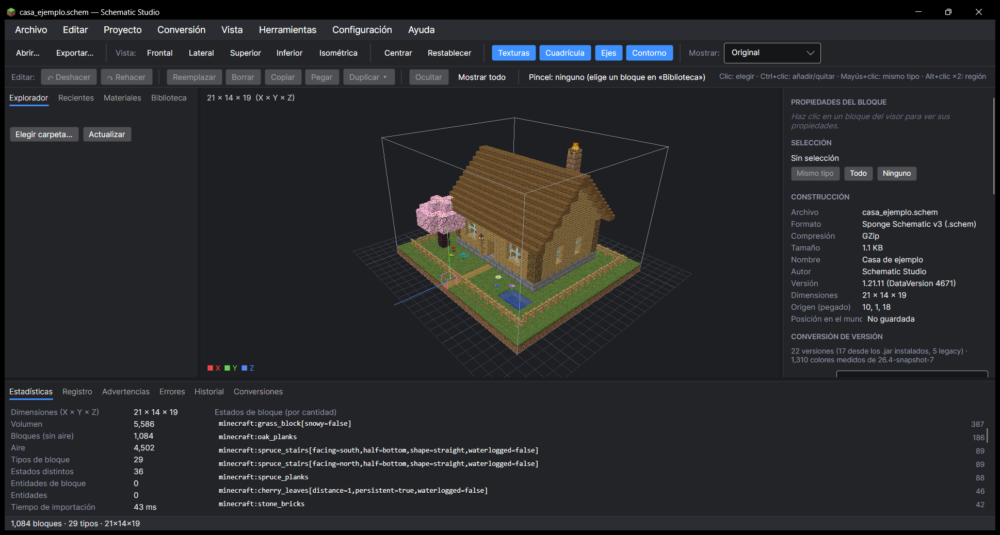

# Schematic Studio

Visor, editor y conversor de construcciones de Minecraft para Windows.

Abre archivos **`.schem`** (WorldEdit), **`.schematic`** (MCEdit / Schematica), **`.litematic`** (Litematica) y **`.nbt`** (bloque de estructuras), los muestra en 3D con las texturas del juego y los convierte entre formatos y versiones de Minecraft (de 1.8 a las más recientes).

## 📖 Guía para principiantes

¿Primera vez? La **[guía paso a paso](wiki/README.md)** explica todo con capturas: instalar, abrir una construcción, convertirla a otra versión, exportarla, editarla y más.

¿Quieres probar sin tener un archivo? Descarga la **[casa de ejemplo](ejemplos/casa_ejemplo.schem)** (botón «Download raw file») y ábrela con el programa.

## ⬇️ Descargar

Ve a **[Releases](../../releases/latest)** y descarga **`SchematicStudio-0.8.0-win-x64.zip`**.

1. Descomprime el `.zip`.
2. Abre **`SchematicStudio.exe`**. No hace falta instalar nada (incluye todo lo necesario).
3. Si Windows muestra «Windows protegió su PC», pulsa **Más información → Ejecutar de todas formas**. Aparece porque el programa no está firmado con un certificado de pago.
4. Opcional: clic derecho en **`Instalar.ps1`** → **Ejecutar con PowerShell** para tenerlo en el menú Inicio (sin permisos de administrador).

## Requisitos

- Windows 10 u 11 de 64 bits, con una tarjeta gráfica compatible con Direct3D 11.
- Para ver las **texturas reales** y **convertir a versiones modernas**: tener Minecraft instalado (launcher oficial o CurseForge) con esas versiones. El programa lee sus archivos en solo lectura; no incluye ni copia ningún recurso del juego. Sin Minecraft instalado funciona igual, con colores en lugar de texturas.

## Qué puede hacer

- **Visor 3D** con las texturas y formas reales de los bloques (escaleras, vallas, cofres, carteles, estandartes con sus dibujos, agua…).
- **Convertir de formato**: de cualquiera de los 4 formatos a cualquier otro.
- **Convertir de versión** (por ejemplo, de 1.21 a 1.12.2): lo que no existe en la versión de destino se sustituye por el bloque más parecido en color y forma, y puedes elegir otro a mano y guardar tus propias reglas.
- **Editar** sobre el modelo 3D: seleccionar, reemplazar, borrar, copiar y pegar, duplicar, deshacer y rehacer.
- **Transformar**: rotar, reflejar, mover, recortar y ajustar el punto de origen (comprobado contra Minecraft).
- **Proyectos** (`.ssproj`) con recuperación automática si el programa se cierra de golpe.
- **Validar** archivos y **comparar** el original con el convertido.
- El archivo original **nunca se modifica**; al exportar se comprueba el resultado leyéndolo de nuevo.

Las exportaciones se han probado en el juego: estructuras colocadas en Minecraft 26.3, 1.21.11 y 1.20.1, archivos cargados con WorldEdit 7.4.2 y `.schematic` colocados en Minecraft 1.12.2.

## Aviso

Schematic Studio es un proyecto independiente: no es un producto oficial de Minecraft ni está aprobado por Mojang o Microsoft.
