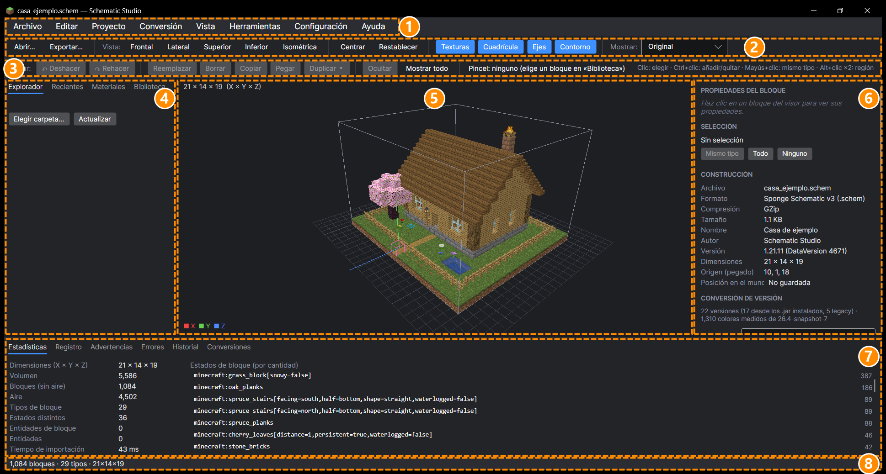

# 2. Conocer la ventana

[← Instalación](01-instalacion.md) · [Índice](README.md) · [Siguiente: Abrir y mirar →](03-abrir-y-mirar.md)

La ventana tiene 8 partes. Los números de la imagen corresponden a la tabla de abajo.

| Nº | Parte | Para qué sirve |
|:-:|---|---|
| 1 | **Menú** | Todas las acciones: Archivo (abrir, exportar, guardar proyecto), Editar, Proyecto, Conversión, Vista, Herramientas, Ayuda. |
| 2 | **Barra de vista** | *Abrir…* y *Exportar…*, vistas de cámara (Frontal, Lateral, Superior…), *Centrar*, y los interruptores **Texturas**, **Cuadrícula**, **Ejes** y **Contorno**. A la derecha, **Mostrar**: Original, Convertido o Comparación. |
| 3 | **Barra de edición** | Deshacer, Rehacer, Reemplazar, Borrar, Copiar, Pegar, Duplicar, Ocultar. Muestra también el **pincel** (el bloque con el que reemplazas). |
| 4 | **Panel izquierdo** | Pestañas **Explorador** (carpeta de archivos), **Recientes**, **Materiales** (lista de bloques) y **Biblioteca** (todos los bloques para usar como pincel). |
| 5 | **Visor 3D** | La construcción en 3D. Arriba a la izquierda, su tamaño (ancho × alto × largo). |
| 6 | **Panel derecho** | Propiedades del bloque elegido, selección, datos de la construcción, conversión de versión, sustituciones y transformaciones. Se desplaza con la rueda del ratón. |
| 7 | **Panel inferior** | Pestañas **Estadísticas**, **Registro** (todo lo que hace el programa), **Advertencias**, **Errores**, **Historial** (ediciones) y **Conversiones** (tabla de sustituciones). |
| 8 | **Barra de estado** | Resumen de lo último que ha pasado y el bloque bajo el ratón. |

> 💡 Los paneles se pueden hacer más anchos o estrechos arrastrando sus bordes, y ocultar desde el menú **Vista**. El programa recuerda cómo los dejaste.

## Los tres modos de «Mostrar»

| Modo | Qué ves |
|---|---|
| **Original** | La construcción tal como está en el archivo. |
| **Convertido** | Cómo quedará en la versión de Minecraft que elijas (solo después de convertir). |
| **Comparación** | Cada bloque coloreado según lo que le pasó al convertir (verde: igual; amarillo: sustituido; rojo: sin equivalencia…). Ver [Convertir](05-convertir-version.md). |
