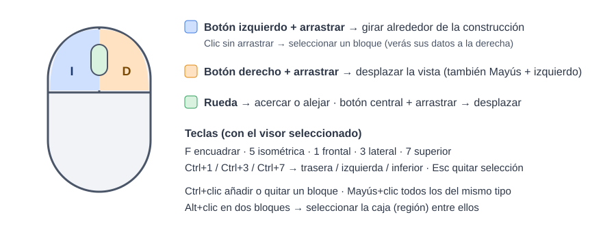
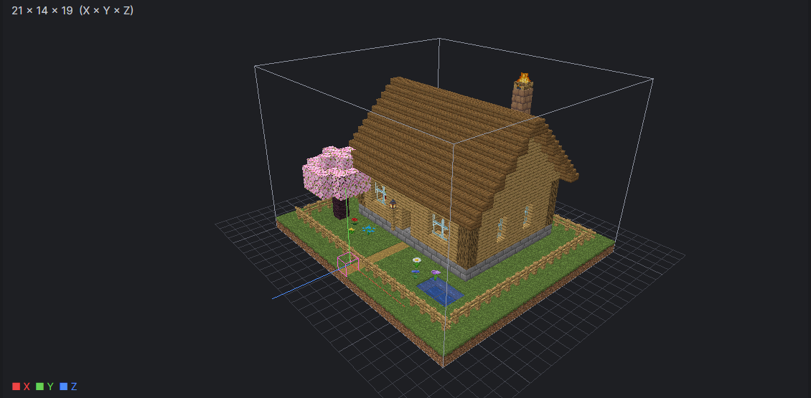
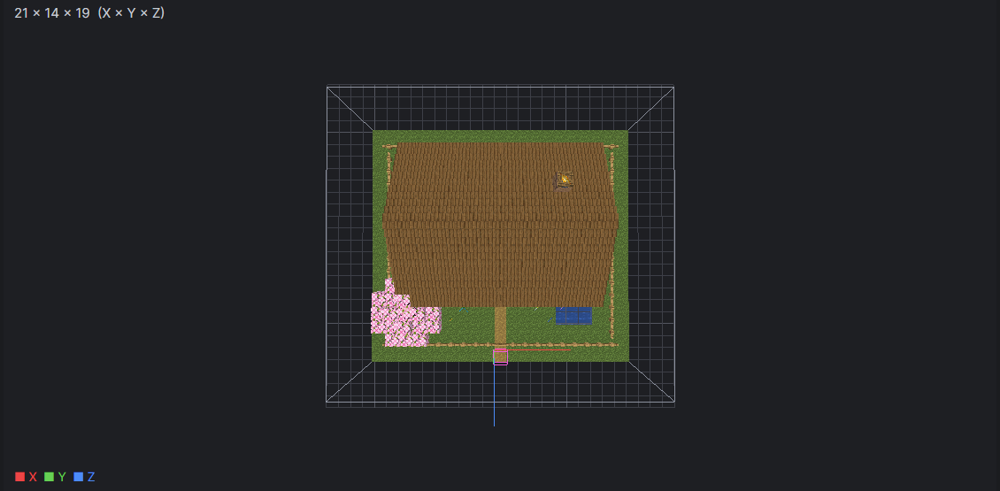
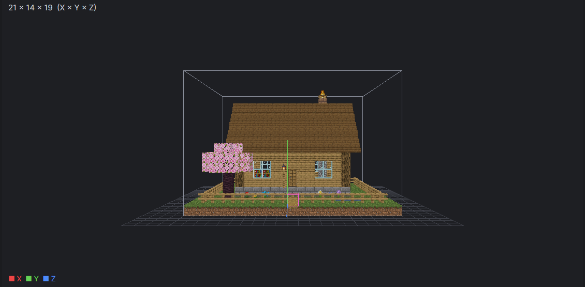
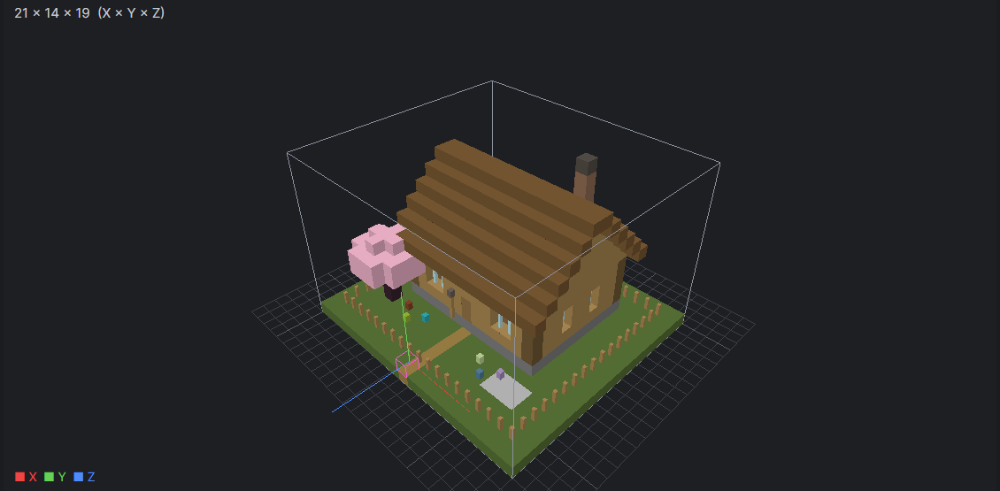
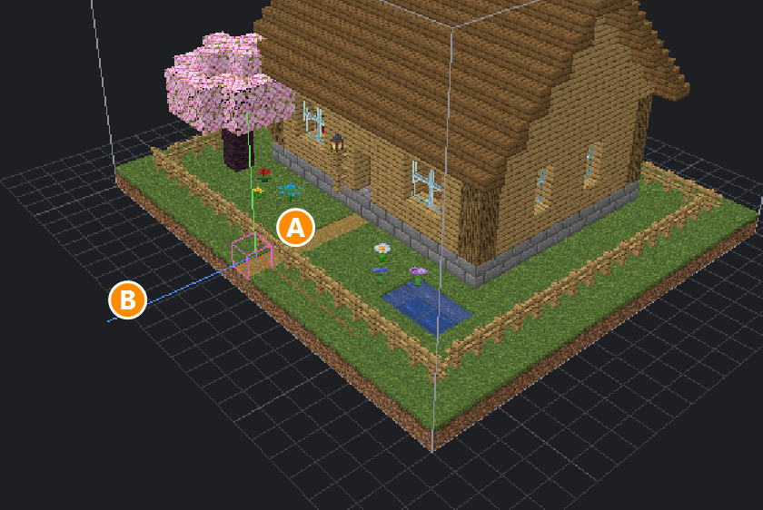

# 3. Abrir y mirar una construcción

[← La ventana](02-la-ventana.md) · [Índice](README.md) · [Siguiente: Información →](04-informacion.md)

## Abrir un archivo

Tienes cuatro maneras, elige la que te resulte más cómoda:

1. Botón **Abrir…** (o **Ctrl + O**) y elige el archivo.
2. **Arrastra** el archivo desde una carpeta y suéltalo encima de la ventana.
3. Pestaña **Explorador** → **Elegir carpeta…** → doble clic en un archivo de la lista.
4. Pestaña **Recientes** → doble clic en uno que ya abriste antes.

Formatos que abre:

| Extensión | De dónde suele venir |
|---|---|
| `.schem` | WorldEdit 7 o FAWE (`//schem save`) |
| `.schematic` | WorldEdit 6, MCEdit, Schematica (Minecraft 1.12.2 o anterior) |
| `.litematic` | El mod Litematica |
| `.nbt` | El bloque de estructuras del juego |

> 🏠 **¿No tienes ningún archivo?** Descarga la [casa de ejemplo](../ejemplos/casa_ejemplo.schem) (botón «Download raw file»). Es la misma que sale en todas las capturas de esta guía.

> El programa reconoce el formato por el **contenido**, no por la extensión: aunque un archivo tenga el nombre mal puesto, lo abrirá. **El archivo original nunca se modifica.**

## Moverse por el visor 3D

Si te pierdes, pulsa **F** (encuadrar) o el botón **Restablecer**.

## Vistas rápidas

| Isométrica (tecla 5) | Superior (tecla 7) | Frontal (tecla 1) |
|---|---|---|
|  |  |  |

## Texturas o colores

El botón **Texturas** cambia entre las texturas reales del juego y un modo de **colores** más simple (útil en ordenadores lentos o para distinguir materiales de un vistazo).

| Con texturas | Solo colores |
|---|---|
|  |  |

## Cuadrícula, ejes, contorno y origen

- **(A) Bloque magenta:** es el **origen** de la construcción, el punto que queda donde está el jugador cuando la pegas con WorldEdit. Se explica en [Transformaciones](08-transformaciones.md).
- **(B) Ejes:** salen del origen. **Rojo = X** (este), **verde = Y** (arriba), **azul = Z** (sur).
- **Contorno:** la caja blanca que rodea toda la construcción.
- **Cuadrícula:** el suelo de referencia, un cuadrado por bloque.

Cada uno se enciende y apaga con su botón en la barra de vista.
