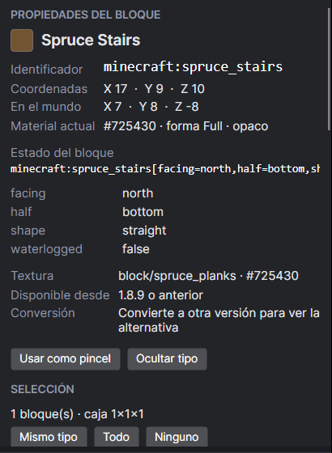
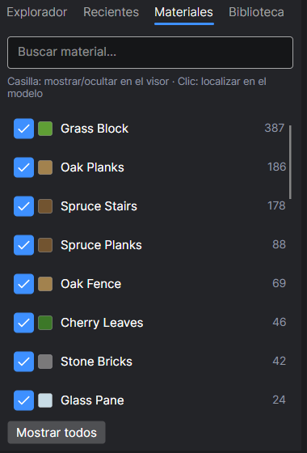

# 4. Información: bloques, materiales y estadísticas

[← Abrir y mirar](03-abrir-y-mirar.md) · [Índice](README.md) · [Siguiente: Convertir →](05-convertir-version.md)

## Ver los datos de un bloque

Haz **clic** sobre cualquier bloque del visor. Se marca en azul y el panel derecho muestra todo sobre él:

| Dato | Qué significa |
|---|---|
| **Identificador** | El nombre interno del bloque en Minecraft (por ejemplo `minecraft:spruce_stairs`). Es el que usarías en un comando `/setblock`. |
| **Coordenadas** | Posición dentro de la construcción (X, Y, Z), empezando en 0. |
| **En el mundo** | Dónde caería en tu mundo, si el archivo guarda la posición original. |
| **Estado del bloque** | Sus propiedades: hacia dónde mira (`facing`), si es la mitad de arriba o de abajo (`half`), forma (`shape`)… |
| **Textura** | La imagen del juego que usa y su color medio. |
| **Disponible desde** | La primera versión de Minecraft en la que existe. |
| **Conversión** | Qué le pasará si conviertes a otra versión. |

Botones:
- **Usar como pincel:** para poner este mismo bloque en otros sitios (ver [Editar](07-editar.md)).
- **Ocultar tipo:** esconde todos los bloques de ese tipo para ver lo que hay detrás (no los borra).

## Lista de materiales

Pestaña **Materiales** (panel izquierdo): todos los bloques de la construcción, de más a menos usado, con su **cantidad**. Ideal para saber qué necesitas reunir para construirla en supervivencia.

- **Clic en un material:** se resaltan en amarillo todos sus bloques en el visor.
- **Casilla:** muestra u oculta ese material en el visor.
- **Buscar material…:** filtra la lista por nombre.

> 💡 Un cofre tiene 27 huecos y cada hueco aguanta 64 bloques (1.728 bloques por cofre). Con la cantidad de la lista puedes calcular cuántos cofres de material necesitas.

## Estadísticas

Pestaña **Estadísticas** (panel inferior):

| Dato | Ejemplo con la casa | Qué significa |
|---|---|---|
| Dimensiones | 21 × 14 × 19 | Ancho (X) × alto (Y) × largo (Z) en bloques |
| Volumen | 5.586 | Todas las posiciones de la caja, incluido el aire |
| Bloques (sin aire) | 1.084 | Los bloques que hay que colocar de verdad |
| Tipos de bloque | 29 | Cuántos bloques distintos usa |
| Estados distintos | 36 | Variantes (por ejemplo, la misma escalera mirando a dos lados cuenta dos) |
| Entidades de bloque | 0 | Cofres, carteles, hornos… con contenido |
| Entidades | 0 | Soportes de armadura, cuadros, animales… |

A la derecha, la lista **Estados de bloque** muestra cada variante exacta con su cantidad.
