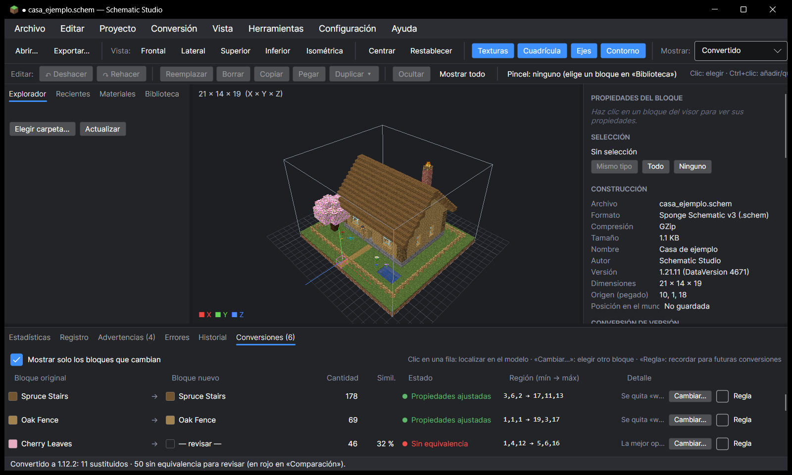
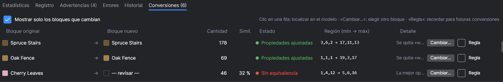
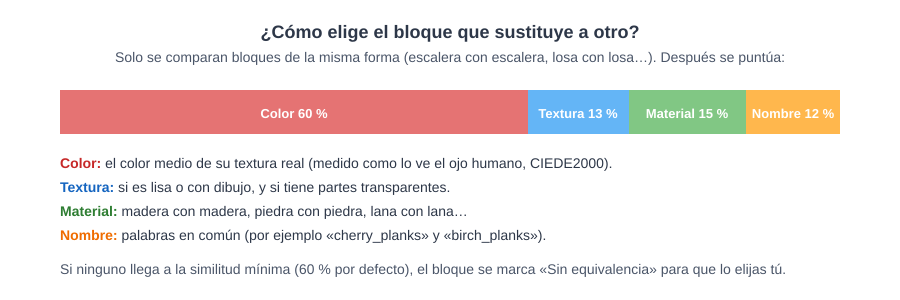
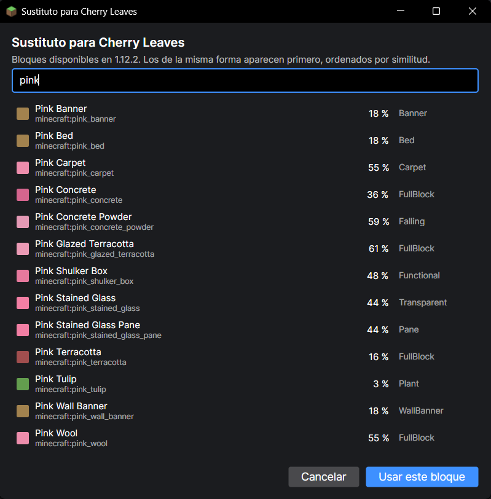
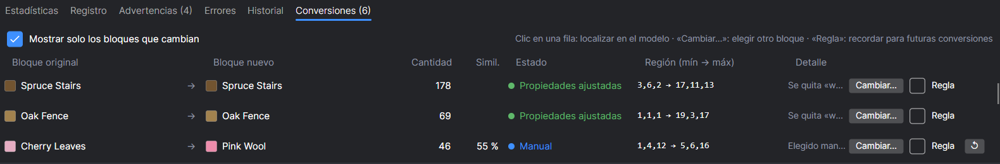
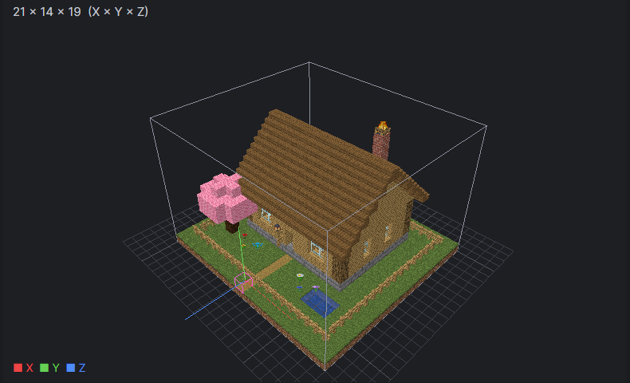
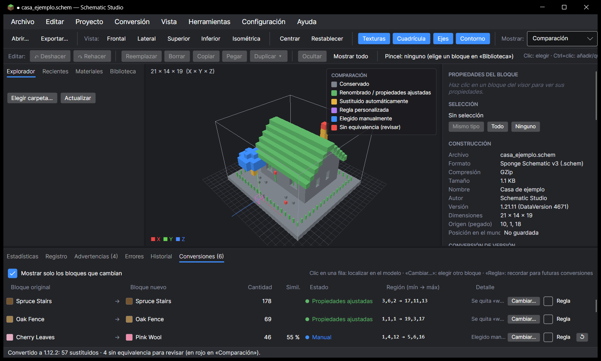

# 5. Convertir a otra versión de Minecraft

[← Información](04-informacion.md) · [Índice](README.md) · [Siguiente: Exportar →](06-exportar.md)

Cada versión de Minecraft tiene bloques distintos. Una casa hecha en 1.21 con **hojas de cerezo** no se puede pegar tal cual en 1.12, porque en 1.12 el cerezo no existe. Schematic Studio cambia esos bloques por los **más parecidos** que sí existen, y te deja revisar y corregir cada cambio.

## Paso a paso

1. Abre la construcción.
2. En el panel derecho, sección **CONVERSIÓN DE VERSIÓN**:
   - **Origen:** la versión del archivo (se detecta sola).
   - **Destino:** la versión a la que quieres llevarla (por ejemplo `1.12.2`).
   - **Similitud:** lo parecido que debe ser un sustituto para aceptarlo solo (60 % por defecto).
3. Pulsa **Convertir** (o **Ctrl + K**).
4. El visor cambia a **Convertido** y abajo se abre la pestaña **Conversiones**.

En el resumen verás algo como: *Conservados 1.023 · Sustituidos 11 · Sin equivalencia 50 · Convertido 95,4 %*.

## La tabla de sustituciones

| Columna | Qué te dice |
|---|---|
| **Bloque original → Bloque nuevo** | Qué bloque se cambia y por cuál |
| **Cantidad** | Cuántos bloques afecta |
| **Simil.** | Lo parecido que es el sustituto (100 % = idéntico) |
| **Estado** | Ver la tabla de colores de abajo |
| **Región** | Zona de la construcción donde están esos bloques (mínimo → máximo) |
| **Cambiar…** | Elegir tú otro bloque |
| **Regla** | Recordar tu elección para todas las conversiones futuras |
| **↺** | Volver a la propuesta automática |

**Clic en una fila:** se resaltan esos bloques en el visor para que veas dónde están.

### Qué significa cada estado

| Color | Estado | Significado |
|:-:|---|---|
| ⚪ | **Conservado** | Existe igual en la versión de destino |
| 🟢 | **Renombrado / Propiedades ajustadas** | Existe, pero con otro nombre o se le quita algo que no existía (por ejemplo «waterlogged» antes de 1.13) |
| 🟡 | **Sustituido** | Cambiado automáticamente por el más parecido |
| 🟣 | **Regla personalizada** | Cambiado según una regla que guardaste |
| 🔵 | **Elegido manualmente** | Lo elegiste tú con «Cambiar…» |
| 🔴 | **Sin equivalencia** | Ningún bloque es lo bastante parecido: **revísalo** |

## Elegir tú el sustituto

En el ejemplo, las **hojas de cerezo** salen «Sin equivalencia» (las más parecidas, hojas de roble, solo se parecen un 32 %). Para arreglarlo:

1. Pulsa **Cambiar…** en esa fila.
2. Escribe en el buscador (por ejemplo `pink`) y elige el bloque. Los de la misma forma aparecen primero, ordenados por parecido.
3. Pulsa **Usar este bloque**.

El árbol ahora es de **lana rosa** en 1.12.2, y la fila pasa a «Manual»:

| Tabla tras el cambio | Resultado en el visor |
|---|---|
|  |  |

> 💡 Marca **Regla** para que la próxima vez que conviertas cualquier construcción con hojas de cerezo a 1.12.2 se use lana rosa automáticamente. Las reglas se pueden **exportar** e **importar** (botones en la sección SUSTITUCIONES) para compartirlas.

## Modo comparación

En **Mostrar → Comparación** cada bloque se pinta del color de su estado. Así ves de un vistazo qué ha cambiado:

En la imagen: el tejado y las vallas en **verde** (iguales, solo se ajustaron propiedades), el árbol en **azul** (elegido a mano), la chimenea y las flores en **rojo/amarillo** (sin equivalencia o sustituidas).
