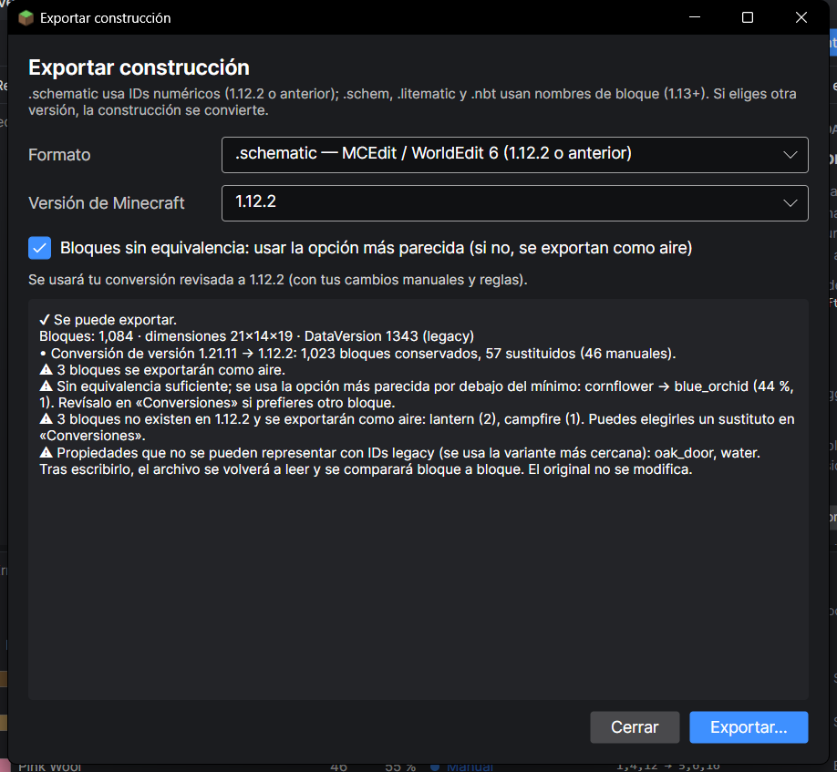

# 6. Exportar (guardar en otro formato)

[← Convertir](05-convertir-version.md) · [Índice](README.md) · [Siguiente: Editar →](07-editar.md)

**Exportar** crea un archivo nuevo con la construcción en el formato y la versión que elijas. El original no se toca.

## Paso a paso

1. Pulsa **Exportar…** (o **Ctrl + E**).
2. Elige el **Formato** y la **Versión de Minecraft** (ver tablas de abajo).
3. Lee el **informe**: te dice si se puede exportar y avisa de todo lo que no encaja (⚠).
4. Pulsa **Exportar…** y elige dónde guardar el archivo.
5. El programa escribe el archivo, **lo vuelve a leer y lo compara bloque a bloque** para asegurarse de que está bien.

En el ejemplo (casa a `.schematic` 1.12.2) el informe avisa de que la **linterna** y la **hoguera** no existen en 1.12.2 y se exportarán como aire, y propone elegirles un sustituto en «Conversiones».

## ¿Qué formato elijo?

| Si vas a usar… | Elige | Versión |
|---|---|---|
| **WorldEdit 7.3 o más nuevo**, FAWE | `.schem` (Sponge v3) | La de tu servidor |
| **WorldEdit 7.0 – 7.2** | `.schem` (Sponge v2) | La de tu servidor |
| **WorldEdit 6, MCEdit o Schematica** | `.schematic` | 1.12.2 o anterior |
| **Litematica** | `.litematic` | La de tu juego |
| **Bloque de estructuras** o `/place template` | `.nbt` | La de tu mundo |

> ⚠ `.schematic` usa números para los bloques y **solo vale hasta 1.12.2**. Los demás formatos usan nombres y **valen desde 1.13**.

## Dónde poner el archivo en Minecraft

| Formato | Carpeta | Cómo cargarlo |
|---|---|---|
| `.schem` / `.schematic` (WorldEdit) | `plugins/WorldEdit/schematics/` del servidor, o `config/worldedit/schematics/` en Fabric/Forge | `//schem load nombre` y luego `//paste` |
| `.litematic` | `.minecraft/schematics/` | Menú de Litematica → *Load Schematics* |
| `.nbt` | `<mundo>/generated/minecraft/structures/` | Bloque de estructuras en modo *Load*, o `/place template minecraft:nombre` |

> ⚠ **Escribe el nombre completo, con la extensión:** `//schem load casa_1-12-2.schematic`. WorldEdit toma lo que va después del último punto como extensión: con `//schem load casa_1.12.2` cree que la extensión es «2» y responde *Invalid file extension*. Evita también los espacios en el nombre. Al exportar, el programa ya propone un nombre seguro y escribe en el **Registro** el comando exacto.

> 💡 El bloque de estructuras solo carga hasta **48 × 48 × 48** desde su menú. Para construcciones más grandes usa `/place template`.

## Si exportas a otra versión

- Si ya **convertiste** a esa versión, se usa tu conversión revisada (con tus cambios manuales y reglas).
- Si no, se convierte automáticamente con tus reglas.
- La casilla **«Bloques sin equivalencia: usar la opción más parecida»** decide qué pasa con los bloques en rojo: marcada, se ponen los más parecidos aunque no lleguen al mínimo; desmarcada, se exportan como aire.

## Seguridad

- Nunca se escribe encima del archivo original.
- Si el archivo de destino ya existe, se guarda una copia `.bak` antes de reemplazarlo.
- Si la comprobación final encuentra diferencias, el programa te lo dice en el registro.
