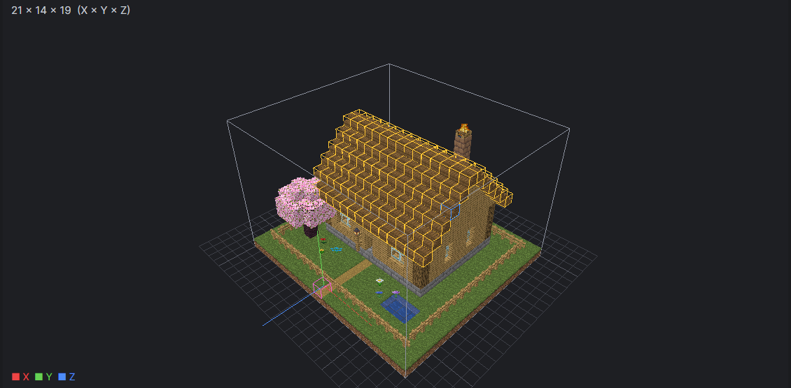
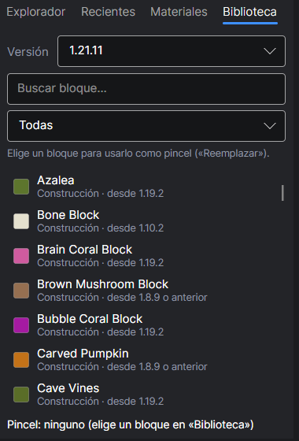
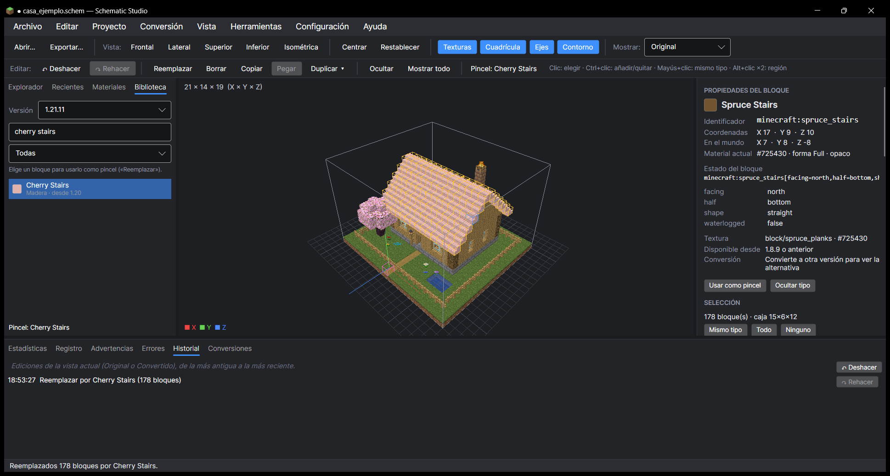

# 7. Editar bloques

[← Exportar](06-exportar.md) · [Índice](README.md) · [Siguiente: Transformaciones →](08-transformaciones.md)

Puedes cambiar bloques directamente sobre el modelo 3D, como en un programa de dibujo. Todo se puede **deshacer** (Ctrl + Z).

## 1. Seleccionar

| Cómo | Qué selecciona |
|---|---|
| **Clic** en un bloque | Ese bloque |
| **Ctrl + clic** | Añade o quita bloques de la selección |
| **Mayús + clic** (o botón **Mismo tipo**) | Todos los bloques iguales al elegido |
| **Alt + clic** en dos bloques | Todos los bloques de la caja entre ellos (región) |
| **Ctrl + A** (o botón **Todo**) | Toda la construcción |
| **Esc** (o botón **Ninguno**) | Quita la selección |

Los bloques seleccionados se ven con borde amarillo. Por ejemplo, **Mismo tipo** sobre una escalera del tejado:

## 2. Elegir el pincel

El **pincel** es el bloque que pondrás. Pestaña **Biblioteca** del panel izquierdo:

1. Elige la **versión** (por defecto, la de tu construcción).
2. Busca por nombre (en inglés, como en el juego: `cherry stairs`, `stone bricks`…) o filtra por **categoría** (Madera, Piedra, Iluminación…).
3. Haz clic en el bloque: aparece como **Pincel** en la barra de edición.

También puedes coger un bloque del modelo: elígelo con clic y pulsa **Usar como pincel** en el panel derecho (como un cuentagotas).

## 3. Aplicar

| Botón | Atajo | Qué hace |
|---|---|---|
| **Reemplazar** | Ctrl + R | Cambia la selección por el pincel. Si son de la misma forma, conserva la orientación (una escalera sigue mirando al mismo lado). |
| **Borrar** | Supr | Quita los bloques (los convierte en aire) |
| **Copiar / Pegar** | Ctrl + C / Ctrl + V | Copia la selección y la pega junto al bloque en el que hagas clic |
| **Duplicar ▾** | Ctrl + D | Repite la selección justo al lado (elige dirección) |
| **Ocultar / Mostrar todo** | Ctrl + H / Ctrl + Mayús + H | Esconde bloques para ver lo que hay detrás (no los borra) |
| **Deshacer / Rehacer** | Ctrl + Z / Ctrl + Y | Vuelve atrás o adelante |

Ejemplo: tejado seleccionado con **Mismo tipo**, pincel **Cherry Stairs** → **Reemplazar**. Las 178 escaleras cambian de golpe y conservan su orientación:

La pestaña **Historial** (abajo) lista todas tus ediciones. El contenido de cofres y carteles viaja con ellos al copiar y vuelve si deshaces.

> 💡 Puedes editar tanto la vista **Original** como la **Convertida**. Las correcciones sobre la convertida se mantienen aunque cambies después una sustitución.
