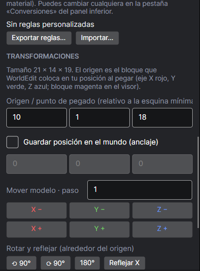
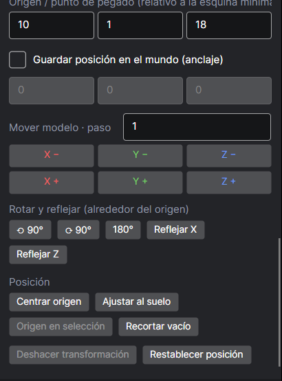
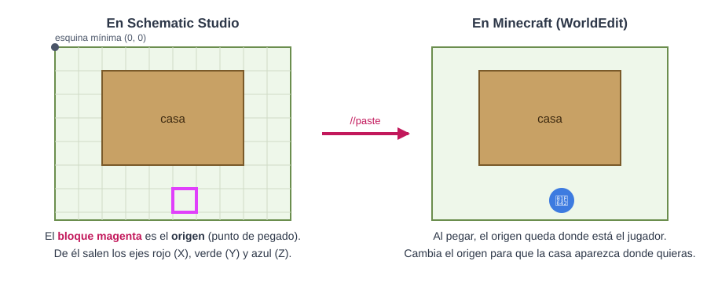
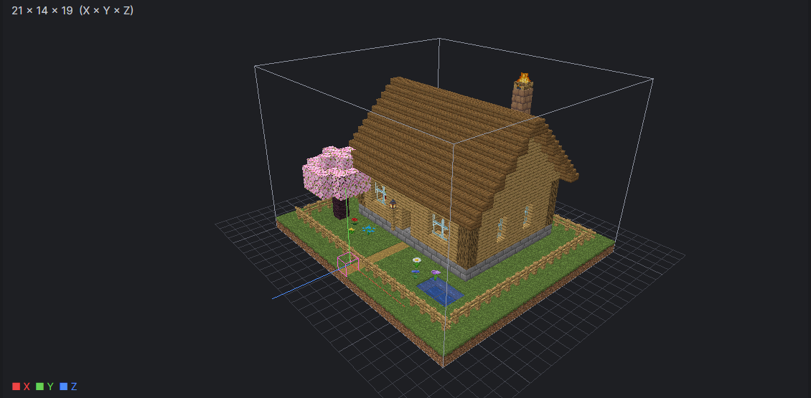
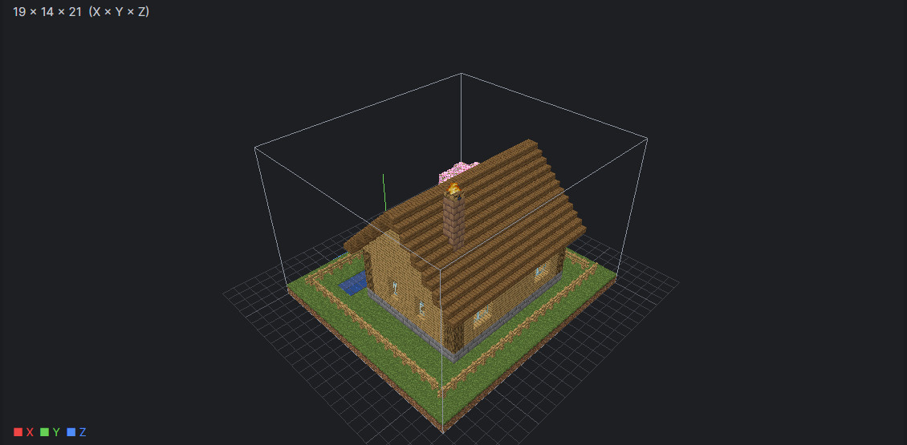

# 8. Girar, reflejar y mover (transformaciones)

[← Editar](07-editar.md) · [Índice](README.md) · [Siguiente: Proyectos →](09-proyectos.md)

El panel **TRANSFORMACIONES** está al final del panel derecho (baja con la rueda del ratón).

| Parte de arriba | Parte de abajo |
|---|---|
|  |  |

## Primero: ¿qué es el «origen»?

Cuando pegas una construcción con WorldEdit (`//paste`), aparece **relativa a donde estás tú**. El bloque de la construcción que queda en tu posición se llama **origen** (o punto de pegado). En el visor es el **bloque magenta**, de donde salen los ejes.

Por ejemplo, en la casa el origen está en la **puerta del jardín**: al pegarla, el jugador queda en la entrada mirando a la casa.

## Origen y posición en el mundo

| Campo | Para qué |
|---|---|
| **Origen / punto de pegado (X, Y, Z)** | Mueve el origen escribiendo coordenadas (relativas a la esquina de la construcción) |
| **Guardar posición en el mundo** | Las coordenadas reales donde estaba la construcción. WorldEdit las usa con `//paste -o` para pegarla exactamente en su sitio original |

## Mover el modelo

Los botones **X − / X + / Y − / Y + / Z − / Z +** mueven la construcción respecto al origen. **Paso** = cuántos bloques por clic. Úsalo, por ejemplo, para que al pegar la casa quede 3 bloques delante de ti.

## Rotar y reflejar

| Botón | Qué hace |
|---|---|
| **⟲ 90° / ⟳ 90°** | Gira 90° a la izquierda o a la derecha (visto desde arriba) |
| **180°** | Media vuelta |
| **Reflejar X** | Espejo este ↔ oeste |
| **Reflejar Z** | Espejo norte ↔ sur |

Los bloques giran **de verdad**: escaleras, puertas, cofres, carteles, raíles, vallas y redstone cambian su orientación para que la construcción funcione igual. Se ha comprobado colocando las mismas construcciones giradas por el propio Minecraft.

| Antes | Después de ⟳ 90° |
|---|---|
|  |  |

## Posición

| Botón | Qué hace |
|---|---|
| **Centrar origen** | Pone el origen en el centro de la base |
| **Ajustar al suelo** | El bloque más bajo queda a la altura de tus pies al pegar |
| **Origen en selección** | Usa el bloque que tienes seleccionado como origen |
| **Recortar vacío** | Quita el aire sobrante alrededor (los bloques no se mueven en el mundo) |
| **Deshacer transformación** | Vuelve atrás la última rotación, reflejo o recorte |
| **Restablecer posición** | Vuelve a la construcción y posición tal como se abrieron |

> 💡 Los cambios de origen y posición se guardan al exportar en `.schem`, `.schematic` y `.litematic`. Las estructuras `.nbt` no guardan origen (siempre se colocan desde su esquina).
