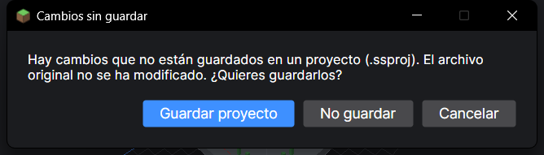
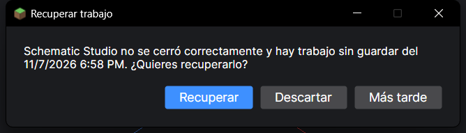

# 9. Proyectos y recuperación automática

[← Transformaciones](08-transformaciones.md) · [Índice](README.md) · [Siguiente: Preguntas frecuentes →](10-preguntas-frecuentes.md)

## ¿Para qué sirve un proyecto?

Exportar crea un archivo para Minecraft. Un **proyecto** (`.ssproj`) guarda **tu trabajo en Schematic Studio** para seguir otro día:

| Se guarda en el proyecto | |
|---|---|
| La construcción con tus ediciones, giros y origen | ✅ |
| La versión de destino, la similitud y tus sustitutos elegidos a mano | ✅ |
| Las correcciones hechas sobre la vista convertida (incluido el contenido de cofres y carteles) | ✅ |
| El historial de **deshacer / rehacer** | ✅ |
| Las últimas 5 transformaciones (para poder deshacerlas) | ✅ |
| El modo de vista (Original / Convertido / Comparación) | ✅ |

## Guardar y abrir

| Acción | Cómo |
|---|---|
| Guardar | **Archivo → Guardar proyecto** o **Ctrl + S** |
| Guardar con otro nombre | **Archivo → Guardar proyecto como…** o **Ctrl + Mayús + S** |
| Abrir | **Proyecto → Abrir proyecto .ssproj…**, doble clic en Recientes, o arrastrar el archivo a la ventana |

El título de la ventana muestra un **●** cuando hay cambios sin guardar. Si cierras así, el programa pregunta:

- **Guardar proyecto:** guarda y cierra.
- **No guardar:** cierra sin guardar (el archivo original sigue intacto).
- **Cancelar:** vuelve al programa.

## Recuperación automática

Cada **2 minutos**, si hay cambios, el programa guarda una copia de seguridad. Si se cierra de golpe (un corte de luz, un cuelgue…), al volver a abrirlo te ofrece recuperar el trabajo:

- **Recuperar:** abre el trabajo tal como estaba en la última copia. Después guárdalo como proyecto (Ctrl + S).
- **Descartar:** borra la copia.
- **Más tarde:** la deja para otro momento (**Proyecto → Recuperar trabajo no guardado…**).

Al cerrar el programa normalmente, la copia se borra sola.
