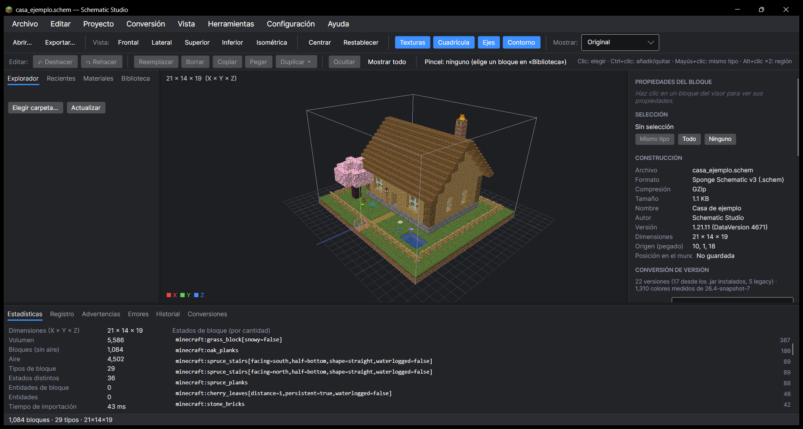
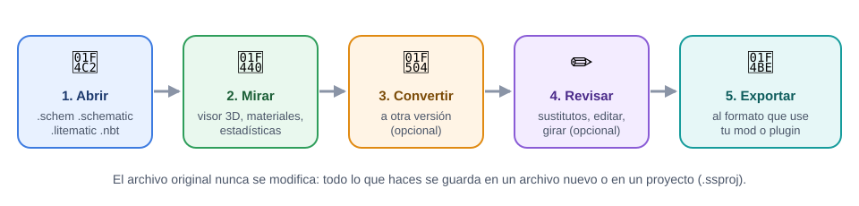

# 📖 Guía de Schematic Studio

Bienvenido. Esta guía explica **paso a paso** cómo usar Schematic Studio, aunque nunca hayas usado un programa de este tipo. Todas las imágenes son capturas reales del programa con una casa de ejemplo.

## ¿Qué es Schematic Studio?

En Minecraft, una construcción (una casa, un castillo, una granja…) se puede guardar en un **archivo** para compartirla o pegarla en otro mundo. Hay varios tipos de archivo según el mod o plugin que uses (WorldEdit, Litematica, el bloque de estructuras…).

Schematic Studio sirve para:

| Quiero… | Schematic Studio lo hace así |
|---|---|
| **Ver** una construcción sin abrir Minecraft | La muestra en 3D con las texturas del juego |
| **Pasarla a otro formato** (por ejemplo de `.litematic` a `.schem`) | Exportar → elegir formato |
| **Usarla en una versión antigua** (por ejemplo de 1.21 a 1.12) | Cambia los bloques que no existen por los más parecidos |
| **Saber qué materiales** necesito para construirla | Lista de materiales con cantidades |
| **Corregir o cambiar bloques** | Editor 3D con deshacer |
| **Girarla, reflejarla o moverla** | Panel de transformaciones |

## Índice

1. [Descargar e instalar](01-instalacion.md)
2. [Conocer la ventana](02-la-ventana.md)
3. [Abrir y mirar una construcción](03-abrir-y-mirar.md)
4. [Información: bloques, materiales y estadísticas](04-informacion.md)
5. [Convertir a otra versión de Minecraft](05-convertir-version.md)
6. [Exportar (guardar en otro formato)](06-exportar.md)
7. [Editar bloques](07-editar.md)
8. [Girar, reflejar y mover (transformaciones)](08-transformaciones.md)
9. [Proyectos y recuperación automática](09-proyectos.md)
10. [Preguntas frecuentes y problemas](10-preguntas-frecuentes.md)
11. [Glosario: palabras que salen en el programa](11-glosario.md)
12. [Datos técnicos: formatos, versiones y pruebas](12-datos.md)

> 💡 **¿Prisa?** Lee solo las páginas 1, 3 y 6: con eso ya puedes abrir una construcción y guardarla en otro formato.
